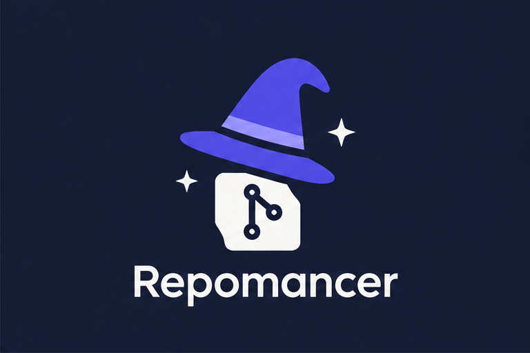

# Repomancer

<p align="center"></p>

Repomancer (formerly Git Manager) is a local web app to manage all your Git repositories in one place, with built-in GitLab and GitHub integration. Clone, commit, branch, merge, resolve conflicts and review merge requests and pull requests from a single dashboard. It runs entirely on your own computer.

- **Frontend:** React 18, Material UI 6 and Vite
- **Backend:** Node.js and Express, running the real `git` on your machine
- **Integrations:** GitLab (any instance, several at once) and GitHub (github.com or Enterprise)

> The app's interface is in Spanish.

## Table of contents

- [Features](#features)
  - [Work environments](#work-environments-entornos-de-trabajo)
  - [Search across repositories](#search-across-repositories)
  - [Commit conventions](#commit-conventions)
  - [Search options](#search-options)
- [Requirements](#requirements)
- [Installation](#installation)
- [Running the app](#running-the-app)
- [Signing in and accounts](#signing-in-and-accounts)
- [Configuration](#configuration)
- [Keyboard shortcuts](#keyboard-shortcuts)
- [Security and privacy](#security-and-privacy)
- [Project structure](#project-structure)
- [npm scripts](#npm-scripts)
- [Troubleshooting](#troubleshooting)
- [Contributing](#contributing)
- [License](#license)

## Features

### Repository list

- Add existing repositories by picking a folder: it is scanned at any depth, nested repositories included, and empty repositories are skipped. You can also clone by URL or from your GitLab projects.
- See the state of every repository at a glance:
  - current branch;
  - uncommitted changes;
  - commits to push (↑) and to pull (↓);
  - unpublished branches;
  - last commit date and author.
- Search by name, path, branch, label, or last commit author and message:
  - multi-word and accent-insensitive;
  - VS Code-style options inside the field: **Aa** match case, **ab** whole word, **.\*** regular expression (also `Alt+C`, `Alt+W`, `Alt+R`);
  - matching text is highlighted;
  - the search survives navigation and page reloads.
- Status filters (with changes, behind, ahead, unpublished), plus **favorites** (always shown first) and colored **labels** to group repositories by client, project or team.
- Sort by name or by last commit date. The sort order and filters are remembered.
- Bulk actions on selected repositories, from a bar that stays at the bottom of the window while you scroll: fetch, pull, favorite, labels, create a group, and remove from the list (files on disk are never deleted).
- Quick actions per repository:
  - pull, push and fetch;
  - open the folder, VS Code or a terminal;
  - open the web page;
  - copy the path.

### Work environments (Entornos de trabajo)

For apps made of several repositories, where each environment uses different branch names in each repository.

- **Groups:** a group gathers the repositories that make up one app. A repository can belong to several groups.
- **Environments:** each group has environments (production, QA, a feature…) that store one branch per repository. Names don't need to match: `api` can use `qa` while `web` uses `test`. A repository without a branch in an environment is left as it is.
- **Quick setup:** create an environment from the branches the repositories are on now, duplicate another one, or fill it in by hand with each repository's branch list.
- **One-click switch** with a preview first. For each repository it shows:
  - current and target branch;
  - uncommitted changes;
  - branches that only exist on origin (a local tracking branch is created);
  - branches that no longer exist (pick another one or skip the repository, and optionally save the choice).
- **Uncommitted changes:** saved in a dedicated stash and restored automatically when you return to that branch. You can also skip those repositories or carry the changes over.
- **Fetch before and pull after** switching, fast-forward only, so a switch never creates a merge.
- **Undo:** "Volver al estado anterior" puts every repository back on the branch it had before the last switch.
- The group card shows the active environment and how many repositories drifted from it, plus a compact table: repository, current branch, and the active environment's branch. A drop-down in the column header shows any other environment without switching, and branches that differ from the current one are flagged.
- Click a repository in the table to open its detail; going back returns to the work environments.
- Cards can be collapsed to just the name, status and environment buttons (switching still takes one click). Each card remembers its state, and you can collapse or expand them all at once.
- Switch from the command palette ("Portal → QA"). Each switch is recorded in the operation log.
- **Group status at a glance:** each card shows how many repositories have uncommitted changes, commits to push or to pull, or "Todo al día". The table shows the same per repository (●changes ↑ahead ↓behind).
- **Deleted branches are flagged:** an environment whose branch no longer exists locally or on origin shows a warning, with the affected repositories in its tooltip and "no existe" in the table, before you try to switch.
- **Fetch, pull and push the whole group** with one click. Pull is fast-forward only, and push only sends branches that are already published and have commits to push.

### Search across repositories

- Search text inside the files of every repository at once, or only in one group's repositories (`Ctrl+Shift+F`).
- Options inside the field, as in VS Code: **Aa** match case, **ab** whole word, **.\*** regular expression. Optionally limit it to file patterns or folders (for example `*.js src/`).
- Or search file names: multi-word and accent-insensitive by default, with the same options.
- Includes uncommitted files and skips anything ignored by `.gitignore`.
- Results are grouped by repository and file with the matches highlighted. Click a line to open the file in VS Code at that line.

### Commit conventions

Set them for all repositories in **Configuración → Commits**, or per repository from the settings button in its commit box.

- **Ticket from the branch:** on a branch like `INC033` or `feature/PAG-112-checkout`, the commit box shows the ticket and adds it when you commit, unless the message already has it. It can go at the start of the summary (`fix(pagos): INC033 corrige el total`), at the end (`… (INC033)`) or in a footer (`Refs: INC033`). Click the ticket chip to skip it for one commit. The ticket pattern is a regular expression you can change.
- **Type and scope picker:** Conventional Commits types (`feat`, `fix`, `docs`…), plus your team's suggested scopes, so `feat(pagos): …` is one click. A warning appears when the summary doesn't follow the format (it can be turned off).
- **Message template:** a team template with `{ticket}`, `{branch}` and `{type}`, inserted with a button or automatically when you start writing.

### Search options

The repository list, branch search, History message search, the add-repositories filter and **Buscar en repositorios** all have the VS Code toggles **Aa** (match case), **ab** (whole word) and **.\*** (regular expression) inside the field, with `Alt+C`, `Alt+W` and `Alt+R` while typing. Each search bar remembers its options. An invalid regular expression turns the field red.

### Repository detail

| Tab | What you can do |
|---|---|
| **Cambios** (changes) | Stage or unstage files and **individual lines**. View diffs, discard changes, and commit (or commit and push, or amend). Commit messages can be generated from the diff following Conventional Commits. See [Commit conventions](#commit-conventions). |
| **Historial** (history) | Branch graph and commit list with filters (message, author, file, date range, all branches) and the diff of each commit. From a commit you can revert, cherry-pick, undo the last commit, tag, or compare. |
| **Ramas** (branches) | Search local and remote branches and check out any of them. Create a branch from **any base**, optionally switching to it and publishing it. Merge (with `--no-ff` if you want), compare, **publish** unpublished branches, and **delete** local branches, with a confirmation and force option when unmerged; the current branch can't be deleted. Bulk-clean merged or gone branches. |
| **Comparar** (compare) | Compare two branches, tags or commits: the commits in between and the full diff. |
| **Archivos** (files) | History of a single file and line-by-line **blame**. |
| **Stash** | Save changes, view each stash's diff, then apply, pop or drop it. |
| **Tags** | Create lightweight or annotated tags, push them and delete them. |

Also in the repository detail:

- **Sync:**
  - **Fetch**.
  - **Pull** with merge or rebase, and optional autostash.
  - **Push**. A branch with no upstream is published with `-u origin`, and a header button publishes the current branch.
- **Conflict resolver:** for merges, rebases, cherry-picks and reverts.
  - Pick ours, theirs or both for each block, or edit the result by hand.
  - Continue or abort the operation.
- **Merge request / pull request button:** adapts to the remote, offering a GitLab MR, a GitHub PR, or a link for other hosts.

### GitLab

- Browse and search the projects of any connected GitLab instance and clone them in one click.
- List merge requests: all visible, created by me, assigned to me, filtered by state or project.
- Open a merge request to read its description, changes and comments, then **comment, approve, close or merge** it (with squash and source-branch deletion).
- Create merge requests from the current branch.
- Several GitLab instances at once, each with its own token, with an instance selector on the GitLab screens.

### GitHub

- Pull requests you're involved in, authored, or asked to review, across all connected GitHub accounts.
- Create pull requests from the current branch, and see the open PR for the branch you're on.
- Supports github.com and GitHub Enterprise.

### Productivity

- **Global search:** `Ctrl+K` jumps to any repository.
- **Command palette:** `Ctrl+Shift+P`, `F1` or `?` gives every action with its shortcut. See [Keyboard shortcuts](#keyboard-shortcuts).
- **Auto-fetch** runs in the background on all repositories (every 10 minutes by default; configurable or can be turned off) so the ↓ counts stay current.
- The **operation log** records every Git operation (fetch, pull, push, commit, merge, branch deletion and so on) with its result and output.
- A **Configuración** (settings) page gathers the theme, clone folder, pull mode, auto-fetch, the default work-environment switch options and the commit conventions, and shows where the app keeps its data.

## Requirements

- **Node.js 20 or later**
- **Git 2.31 or later.** On Windows, install [Git for Windows](https://git-scm.com/download/win).
- A modern browser (Chrome, Edge or Firefox)
- Windows, macOS or Linux. The [start with Windows](#start-with-windows) option is Windows-only.

## Installation

```bash
git clone https://github.com/elmogof/Git-Manager-Local-Remote.git repomancer
cd repomancer
npm install
```

`npm install` installs the server and client together (npm workspaces).

## Running the app

### Development (hot reload)

```bash
npm run dev
```

Open <http://localhost:5173>. Vite serves the client and forwards `/api` to the server on port 4000. The server restarts on its own when you change its code.

### Production (single process)

```bash
npm start
```

This builds the client and serves everything from <http://localhost:4000>.

### Start with Windows

To have the app always available at <http://localhost:4000> without opening a terminal:

```bash
npm run startup:install
```

This command:

- builds the client;
- creates a Task Scheduler task named **Repomancer**, which starts the server with no window every time you sign in to Windows;
- adds a **Repomancer** shortcut to the Start menu;
- removes the old **Git Manager** task and shortcut, if you installed it before the rename.

The server runs as your user, so "Open terminal", "Open in VS Code" and your Git credentials keep working. That is why it is a sign-in task and not a Windows service.

| Command | What it does |
|---|---|
| `npm run startup:status` | Shows whether the task exists and whether the app responds |
| `npm run startup:stop` / `npm run startup:start` | Stops or starts the server |
| `npm run startup:restart` | Rebuilds the client and restarts. Run it after pulling or changing code. |
| `npm run startup:uninstall` | Removes the task and the shortcut |

Both the task and `npm run dev` use port 4000. Run `npm run startup:stop` before developing and `npm run startup:start` afterwards. The server output goes to `server.log` in your config folder.

## Signing in and accounts

On the login screen, choose **GitLab** or **GitHub**. You can connect the other one later from the avatar menu or from **Cuentas** (accounts). If you sign in only with GitHub, the GitLab screens ask you to connect GitLab.

### Built-in sign-in apps (gitlab.com and github.com)

If `oauth-apps.json` at the project root contains Client IDs, people who use **gitlab.com** or **github.com** only click "Iniciar sesión" and never see any setup steps. These IDs are public by design: GitLab OAuth uses PKCE and the GitHub device flow uses no secret, and each person's token still stays only on their own computer. A "Usar otro Application ID" / "Usar otro Client ID" link lets anyone use their own app instead, and self-hosted GitLab servers use their own app (see below).

The login screen works the same way for both providers:

- It signs in to **gitlab.com** or **github.com** by default. The server address field only appears after clicking "¿GitLab propio (self-managed)?" or "¿GitHub Enterprise?".
- The Application ID or Client ID you use is **remembered per server** after a successful sign-in, so next time that server only needs one click.

```json
{
  "gitlab": { "url": "https://gitlab.com", "clientId": "<GitLab Application ID>" },
  "github": { "url": "https://github.com", "clientId": "<GitHub Client ID>" }
}
```

`"gitlab"` can also be a list, to add a self-hosted GitLab (for example your company's) whose app you registered there:

```json
"gitlab": [
  { "url": "https://gitlab.com", "clientId": "<gitlab.com Application ID>" },
  { "url": "https://gitlab.example.com", "clientId": "<Application ID registered on that server>" }
]
```

You can also set them with the environment variables `REPOMANCER_GITLAB_CLIENT_ID` and `REPOMANCER_GITHUB_CLIENT_ID`.

**Creating the gitlab.com app** (once, by the maintainer):

1. Sign in to gitlab.com and open **Edit profile → Applications** (<https://gitlab.com/-/user_settings/applications>), then click **Add new application**.
2. **Name:** `Repomancer`. People see this name when they authorize the app.
3. **Redirect URI:** `http://localhost:4000/api/auth/oauth/callback`
4. **Confidential:** unchecked.
5. **Scopes:** `api`, `read_user`, `read_repository`, `write_repository`
6. Click **Save application** and copy the **Application ID** into `oauth-apps.json`. The secret is not used.

**Creating the github.com app** (once, by the maintainer):

1. Open **Settings → Developer settings → OAuth Apps → New OAuth App** (<https://github.com/settings/applications/new>).
2. **Application name:** `Repomancer`. **Homepage URL:** your repository URL, for example `https://github.com/elmogof/Git-Manager-Local-Remote`.
3. **Authorization callback URL:** `http://localhost:4000`. It isn't used by the device flow, but GitHub requires one.
4. Click **Register application**, check **Enable Device Flow**, and click **Update application**.
5. Copy the **Client ID** into `oauth-apps.json`. Don't generate a client secret; it isn't needed.

### GitLab account (username and password, Microsoft…)

This uses GitLab's OAuth 2 with PKCE. The app sends you to your GitLab sign-in page, where you sign in with your username and password or with Microsoft or another provider your GitLab offers. **The app never sees your password.** The token renews itself when it expires.

You register the app once:

1. In GitLab, open **Preferences → Applications** (`https://<your-gitlab>/-/user_settings/applications`) and click *Add new application*.
2. **Name:** `Repomancer local`
3. **Redirect URI:** `http://localhost:4000/api/auth/oauth/callback`. If you use another port, change it to match.
4. **Confidential:** unchecked. PKCE is used, so no secret is needed.
5. **Scopes:** `api`, `read_user`, `read_repository`, `write_repository`
6. Save, then paste the **Application ID** on the login screen. It's remembered for that server, so you only do this once.

If your user can't create applications, a GitLab administrator can create one for the whole instance (*Admin → Applications*) with the same values.

### GitLab personal access token

1. Go to **Preferences → Access tokens** (`https://<your-gitlab>/-/user_settings/personal_access_tokens`).
2. Create a token with the scopes `api`, `read_repository` and `write_repository`, and give it an expiration date.
3. Paste it in the **Token personal** tab.

### GitHub account (username and password)

This uses GitHub's **device flow**, so there is no password, secret or callback URL in the app:

1. Click **Iniciar sesión con GitHub**. The app shows a code, copies it, and opens `github.com/login/device`.
2. Sign in to GitHub as usual (including 2FA), enter the code and authorize.
3. The app finishes signing you in on its own.

You register the app once:

1. Open **Settings → Developer settings → OAuth Apps → New OAuth App** (<https://github.com/settings/applications/new>).
2. **Application name:** `Repomancer local`. **Homepage URL** and **Authorization callback URL** can both be `http://localhost:4000`. They aren't used, but GitHub requires them.
3. Click **Register application**, then check **Enable Device Flow** and save.
4. Paste the **Client ID** on the login screen. The client secret is not needed.

### GitHub personal access token

Create a token (classic) at **Settings → Developer settings → Personal access tokens** with the scopes `repo`, `read:user` and `read:org`, then paste it in the **Token personal** tab of the GitHub section.

### Extra accounts

In **Cuentas** you can add more GitLab instances and GitHub accounts, each with its own personal access token. The app uses the account that matches each remote's host for fetch, pull and push, and for merge requests and pull requests.

**Cerrar sesión** (sign out) disconnects the GitLab and GitHub accounts you signed in with. Accounts added from **Cuentas** stay until you remove them there.

## Configuration

### Environment variables

| Variable | Default | Description |
|---|---|---|
| `PORT` | `4000` | Server port. The OAuth redirect URI changes with it (`http://localhost:<PORT>/api/auth/oauth/callback`). |
| `REPOMANCER_HOME` | `~/.repomancer` | Folder for the configuration, operation log and server log |
| `REPOMANCER_GITLAB_CLIENT_ID` / `REPOMANCER_GITHUB_CLIENT_ID` | from `oauth-apps.json` | Built-in OAuth app IDs for gitlab.com and github.com |

The old names from before the rename (`GIT_MANAGER_HOME`, `GIT_MANAGER_GITLAB_CLIENT_ID`, `GIT_MANAGER_GITHUB_CLIENT_ID`) still work.
| `CLIENT_URL` | `http://localhost:5173` in development, `http://localhost:<PORT>` in production | Where the GitLab OAuth callback sends you back |

For example, with PowerShell:

```powershell
$env:PORT = 5000; npm start
```

### Files

All of these live in `REPOMANCER_HOME` (`C:\Users\<you>\.repomancer` on Windows), outside the project. They are never committed.

If you used the app when it was called Git Manager, the first start moves your `.git-manager` folder to `.repomancer`, so your sessions, repositories and settings carry over.

| File | Contents |
|---|---|
| `config.json` | Sessions and tokens, your repository list with favorites and labels, groups and work environments, extra accounts, OAuth app IDs, and auto-fetch settings |
| `oplog.json` | The operation log (most recent entries) |
| `server.log` | Server output when started by the Windows task. It rotates at 1 MB to `server.old.log`. |

The sort order, filters, pull options, work-environment switch options and theme are stored in your browser. You can change them all in **Configuración**.

### Auto-fetch

Click the cloud icon in the top bar, or open **Configuración**, to turn auto-fetch on or off and choose the interval. It runs on the server, so it keeps going while the browser tab is closed, as long as the server is running.

## Keyboard shortcuts

Shortcuts without `Ctrl` or `Alt` only work when you're not typing in a field. `?` opens the full list in the command palette.

| Where | Keys | Action |
|---|---|---|
| Anywhere | `Ctrl+K` | Search repositories |
| Anywhere | `Ctrl+Shift+P`, `F1`, `?` | Command palette |
| Anywhere | `Alt+1` … `Alt+9` | Go to a section |
| Anywhere | `Ctrl+Shift+F` | Search text or files across repositories |
| Anywhere | `Alt+T` / `Alt+M` | Toggle the theme / the sidebar |
| Repository list | `/` | Search in the list |
| Repository list | `a` / `n` / `r` | Add repositories / clone / refresh |
| Repository detail | `1` … `7` | Switch tab |
| Repository detail | `f` / `p` / `Shift+P` | Fetch / pull / push |
| Repository detail | `c` / `a` / `s` / `t` | Write the commit message / stage all / stash / new tag |
| Repository detail | `r` / `Backspace` | Refresh / back to the list |

## Security and privacy

- **Local only.** The server listens on `127.0.0.1`, so nobody on your network can connect to it.
- **Tokens stay on your machine.** They are stored in `config.json` with permissions for your user only, and never sent to the browser.
- **Tokens never land in your repos.** For hosts with a connected account, the token is passed to Git as an HTTP header through environment variables. It is never written to `.git/config` or into remote URLs. Other remotes use your usual Git credentials (SSH, Git Credential Manager…).
- **Protection against other websites.** Every API call requires a custom header, so other web pages open in your browser can't send commands to the server.
- **Passwords are never seen.** GitLab and GitHub sign-in happen on their own sites (OAuth with PKCE and the device flow).
- **Nothing is deleted from disk.** Removing a repository from the list only removes it from Repomancer.

## Project structure

```
repomancer/
├── package.json             # workspaces and top-level scripts
├── oauth-apps.json          # built-in public OAuth app IDs (gitlab.com, github.com)
├── scripts/startup/         # Windows sign-in task (startup.ps1, launch.mjs)
├── server/                  # Node + Express API
│   └── src/
│       ├── index.js         # server, CSRF check, static files
│       ├── config.js        # local config in ~/.repomancer
│       ├── home.js          # data folder (moves the old ~/.git-manager)
│       ├── git.js           # runs git and injects credentials
│       ├── gitlab.js        # GitLab API, OAuth 2 + PKCE, multiple instances
│       ├── github.js        # GitHub API client
│       ├── githubAuth.js    # GitHub sign-in (device flow and token)
│       ├── accounts.js      # extra GitLab and GitHub accounts
│       ├── autofetch.js     # background fetch scheduler
│       ├── oplog.js         # operation log
│       ├── commitmsg.js     # commit message suggestions
│       ├── commitSettings.js # commit conventions (general and per repository)
│       ├── scan.js          # finds repositories inside a folder
│       ├── open.js          # opens folder, VS Code or terminal
│       └── routes/          # auth, repos, workspaces, search, gitlab, github, accounts, fs, auto-fetch, oplog
│   └── tests/               # automated tests (node:test) against throwaway repositories
└── client/                  # React + Vite + Material UI
    └── src/
        ├── App.jsx          # layout, navigation, routes
        ├── theme.js         # light and dark themes
        ├── pages/           # Login, Repos, Workspaces, Search, Settings, RepoDetail, History, Branches, Compare, FileHistory,
        │                    # Stashes, Tags, Projects, MergeRequests, PullRequests, OpLog, Accounts
        └── components/      # DiffView, ConflictResolver, CommitBox, dialogs, command palette…
```

## npm scripts

| Script | Description |
|---|---|
| `npm run dev` | Server and client in development mode (port 5173) |
| `npm run build` | Builds the client into `client/dist` |
| `npm test` | Runs the server tests (work environments, search, commit conventions, history search) on temporary repositories with an isolated server |
| `npm start` | Builds and runs the production server (port 4000) |
| `npm run startup:install` | Installs the Windows sign-in task and the Start menu shortcut |
| `npm run startup:start` / `npm run startup:stop` / `npm run startup:restart` / `npm run startup:status` / `npm run startup:uninstall` | Manage the sign-in task |

## Troubleshooting

| Problem | Solution |
|---|---|
| `EADDRINUSE` / port 4000 already in use | The sign-in task or another `npm run dev` is running. Run `npm run startup:stop`, or use another `PORT`. |
| GitLab says *"The redirect URI included is not valid"* | The redirect URI in the GitLab application must match `http://localhost:<PORT>/api/auth/oauth/callback` exactly. |
| GitHub: *"Enable Device Flow"* error | Open your OAuth App in GitHub, check **Enable Device Flow**, and save. |
| Push or pull asks for credentials or fails | Connect an account for that host in **Cuentas**, or set up SSH or Git Credential Manager for it. |
| `git` not found | Install Git and make sure `git --version` works in a new terminal. |
| Changes don't show on port 4000 | The sign-in task serves the built client. Run `npm run startup:restart`. |

## Contributing

1. Create a branch from `main`.
2. Run `npm run dev` and test against **throwaway repositories**, not real ones. Run `npm test` before committing; the tests create their own temporary repositories and server, and never touch your configuration.
3. Write commit messages in English, in the imperative mood ("Add…", "Fix…"), with a short body when the change needs context.
4. Open a pull request.

## License

[MIT](LICENSE) © 2026 Máximo Javier Aráuz Vigil. You can use, copy, modify and share this software freely, as long as the license notice is kept.
